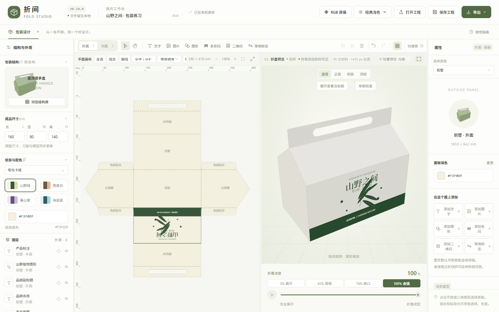

# 折间 Fold Studio

**简体中文** ｜ [English](README.en.md)

一个以流畅编辑为优先的本地网页包装工作台。参考 [OpenBox3D](https://github.com/yuyou-dev/OpenBox3D) 的“参数化刀版 → 平面设计 → 三维折叠”工作流，重新实现轻量渲染与交互。原项目仅作设计和技术研究参考，未复制其应用源码、预设或素材。

**在线体验：** [tool.heyunxi.top/fold](https://tool.heyunxi.top/fold)
**开源许可：** MIT，版权署名 Yun-xi、OpenAI Codex 与 DeepSeek Harness。第三方代码和图标的许可见 [THIRD_PARTY_NOTICES.md](THIRD_PARTY_NOTICES.md)。
**贡献者：** [Yun-xi 与 OpenAI Codex](CONTRIBUTORS.md)。



## 快速开始

**在线直接用：** 打开 [tool.heyunxi.top/fold](https://tool.heyunxi.top/fold)，无需注册。

**离线单文件：** 从 [Releases](https://github.com/YunxiQWQ/fold-studio/releases) 下载 `fold-studio-v0.11.0.html`（离线单文件），双击用 Edge 或 Chrome 打开。无需安装、联网或启动服务器，全部运行代码已内联。

**便携包：** [下载 v0.11.0 ZIP](https://github.com/YunxiQWQ/fold-studio/releases/download/v0.11.0/fold-studio-v0.11.0.zip)，含相同的离线 HTML、使用说明、更新记录、贡献者说明和许可文件。发布页同时提供 SHA-256 校验值。

**本地构建：** 需要 Node.js 22 或更新版本。

```sh
npm ci
npm run build
npm run dev
```

**本机 HTTP 版：** 构建后双击 `启动折间.cmd`，或执行：

```powershell
node server.mjs --open
```

默认地址 `http://127.0.0.1:4186`，端口占用时依次尝试后续端口，以终端实际显示为准。服务器只绑定 `127.0.0.1` 并提供 `dist/` 静态资源。关闭窗口或按 `Ctrl+C` 停止。同一浏览器中，离线单文件版和 HTTP 版的工程库分开保存，可通过 `.fold` 工程互相传递。

## 已实现

### 参数化结构

- **三十款参数化包装结构与瓶罐容器**，尺寸范围 15–600 mm，按四大行业场景分类：
  - **卡纸彩盒**：顺插舌纸盒、反插舌纸盒、扣底彩盒、弧线扭转盒、锁盖卡牌盒、翻盖展示盒、胶底插盖零售盒、盐纸盒、三角柱盒
  - **精品礼盒**：天地盖盒、抽拉抽屉盒、书型翻盖盒、一体成型弧顶手提盒、直顶提手盒、手提纸袋、绳提手折顶礼盒
  - **电商物流**：翻盖飞机盒、对口运输箱（RSC）、全搭盖运输箱、包装腰封、开放托盘
  - **瓶罐容器**：迷你便携罐、纤体高罐、经典易拉罐、纤秀摩登罐、大容量高罐、空白圆形金属罐、食品罐头高罐、食品罐头矮罐、旋盖金属罐
- **结构库弹窗**：侧边栏保留当前盒型卡片与“浏览结构库”入口；全屏模态窗口支持「全部 / 卡纸彩盒 / 精品礼盒 / 电商物流 / 瓶罐容器」分类筛选，卡片含分类角标、中英文命名与默认尺寸，选择需二次确认。
- **真实模型缩略图**：结构库、侧栏与属性区共用同一套由实际模型渲染的图像，构建时生成、运行时内嵌，不额外增加 WebGL 上下文。
- **圆柱容器**：按 $W = \pi \times D$ 自动计算环绕尺寸，2D 提供罐顶/罐底标对位，3D 实现 0% 平铺到 100% 环绕的非线性卷曲；铝罐带拟真金属卷边与拉环。
- **手提纸袋**：一个模型提供横款 425×129×322、方款 330×100×250、竖款 220×80×311 mm 三组预设；长、侧宽、高、袋口折边、折底、粘口、提手弧高和间距可调。绳/缎带、提起/垂落可切换；绳孔与内折加固边对齐。刀版为连续矩形，侧风琴及折底斜线为压痕，平铺导出不包含独立提手。
- **三角柱盒与绳提手折顶礼盒**：三角柱盒默认柱长 200、底边 74、等腰斜边 74 mm，展开 326×237 mm，实际截面高约 64.1 mm，支持站放/平放和折边三角端盖。绳提手折顶礼盒默认直身 300×120×202 mm，折顶展开 61、顶盖 56、锁底 84、侧粘口 45 mm，刀版 885×403 mm；盒体另增加约 51.9 mm 折顶高度，不含绳高。保留孔圈、提绳孔、窄顶舌穿槽、侧顶斜压痕与异形底扣，尺寸可调。参考图的成品标签与分段有差异，以上按刀版分段定义。
- **纸厚避让**：天地盖、抽屉封套、书型硬壳保留纸厚间隙；插舌、防尘翼与盒壁闭合时引入物理微层间距，消除共面闪烁与串面。
- **弧线扭转盒**：按参考图保留八条二次曲线压痕、中心直压痕、13 mm 粘口、上下反向插盖与圆角插舌。默认四段各 80 mm、盒身高 160 mm，盖深 80 mm、插舌 16 mm，展开为 333 × 352 mm；原图模糊且总尺寸与分段不一致，依用户确认采用分段尺寸。长宽联动为正方形截面，上口相对下口转 45°。平面、选面、双面贴图、折叠预览、SVG 曲线与 GLB 曲面一致；三维为几何变形预览，未作纸材应变、接触或实物打样验证。

### 平面编辑

平面交互基于 **Fabric.js 7.4.0（MIT）**，选型比较见 [EDITOR_REUSE.md](EDITOR_REUSE.md)。

- 框选、Shift / Ctrl 增减选、跨面板批量选择当前印刷面的图层。
- 八方向缩放、拖动旋转与角度吸附、整体多选变换；同面组合/解组，组合可保存并跨基准面板。
- 边缘/中心对齐、水平/垂直等间距分布；面板与图层吸附线、毫米标尺、网格开关。
- 图层锁定、拖动排序、置顶置底、多选复制删除、批量颜色与透明度、右键菜单。
- 双击画布原位编辑文字，支持中英文、多行、自动换行、段落对齐、粗体/斜体/下划线、行距、字距、描边与等宽字体。
- 图片非破坏裁剪：拖动取框、百分比精调、1:1 / 16:9 预设、实时 3D 更新、取消与撤销，支持保留位置替换图片。
- 形状工具：矩形、椭圆、植物图形、三角形、箭头、线条，支持圆角与描边。

### 内外面与排版范围

- 外面 / 内面各自独立的图层、纸色与逐面填色，内面按纸张背面方向显示，3D 同时保留两面贴图。
- 图文默认跨整张刀版连续排版，可直接拖过折线延伸到相邻面板；图层属性可切换为「仅基准面板」裁切。平面、命中、3D 图集与导出范围保持一致。
- 多图层跨页面、跨印刷面系统剪贴板，保留实际尺寸、相对排布、图层样式与组合编号。

### 包装要素

- **EAN-13**：内置校验算法，12 位自动补第 13 位；标准 95 模块、下沉护栏延长线与左右数字排版。
- **Code 128**：大小写字母、数字与常用半角符号，最多 120 字符，自动生成模 103 校验码。
- **二维码**：本地打包 [node-qrcode](https://github.com/soldair/node-qrcode) 1.5.4（MIT），支持 L/M/Q/H 纠错、中英文与长内容，容量不足直接提示不截断。
- **标志库**：34 款可搜索、分类、预览的矢量图形，分运输储存、回收材质、食品日用；其中 26 款选自 [Pictogrammers MDI](https://github.com/Templarian/MaterialDesign-SVG)（Apache-2.0）。
- 条码与二维码支持白色工业底衬开关、透明底、下方文字开关；编辑即时重绘。

### 配色与主题

- 调色盘基于 [vanilla-colorful](https://github.com/web-padawan/vanilla-colorful) 0.7.2（MIT），纸张、逐面背景、图层填色、描边与批量改色共用同一界面。
- 饱和度/明度面板、色相滑条、HEX/RGB 精确输入、工程色、持久化最近用色、CMYK 参考值，浏览器支持时可屏幕取色。
- 拖动实时反映到 2D/3D，完成时合并为一步历史；取消或 Esc 逐个恢复各图层原色。
- 五套主题：工业中灰、极夜深色、工程蓝灰、经典浅色、暖沙原纸；顶栏菜单切换，`Shift + T` 循环，偏好写入 `localStorage`。2D 刀线、压痕虚线、尺寸标注与 3D 摄影棚渐变随主题自适应。

### 三维预览

- 折叠滑杆与播放动画，透视 / 正 / 侧 / 顶四视图，节能 / 均衡 / 清晰三档画质。
- 点击平面或三维选择面板与印刷面，射线拾取忽略隐藏面并尊重遮挡。
- 「展开查看当前面」与「单面检查 / 返回整盒」独立隔离观察，调整窗口后保留检查状态。
- 视口可全宽展开（`M` 键切换），专注平面排版时 3D 自动适配视角。

### 导出

- **GLB**：glTF 2.0 二进制单文件，内嵌网格、命名面板节点、PBR 材质、纸张切口与内外两面烘焙贴图（1024 / 2048 / 4096 px）；支持当前角度、100% 成型、0% 平铺三种形态，兼容 Blender、C4D、KeyShot、Windows 3D 查看器与 Web/AR。
- **PNG**：三维截图，或透明背景的平面图。
- **SVG**：刀线为矢量，图文为嵌入位图，附带可重新打开的工程元数据。
- **.fold 工程**：导入导出，含内外两面；旧版单面工程自动归为外面。

### 工程与存储

- 撤销重做（40 步）、最多 120 图层。
- “我的工程”可在当前浏览器建立、打开、复制多个工程；导入 `.fold` 会建立新工程，不覆盖原设计。
- IndexedDB 自动保存当前工程，并为每个工程保留最多 12 个历史版本；编辑期间约每 5 分钟记录一次，也可手动保存或恢复。旧版单草稿会复制进独立工程库，原记录不删除，旧版离线文件仍可打开。
- 工程和历史版本只属于当前浏览器与网站地址。换浏览器、清理网站数据或使用另一个地址时，需用下载的 `.fold` 文件转移；重要设计请定期下载备份。
- 完全本地运行，不需要账号、后端、外部字体或云端图片服务。

## 快捷键

`1` / `2` 切换外面 / 内面 · `V` 选择 · `H` 平移（或按住空格）· `T` 文字 · `I` 图片 · `R` 矩形 · `M` 展开/恢复平面编辑 · `P` 切换 CMYK 软打样与 RGB · `Shift+T` 循环主题 · `F` 适应平面 · `Shift+F` 适应三维 · `G` 组合 / 辅助线 · `Shift+G` 解组 · `L` 锁定 · `B` / `I` / `U` 文字样式 · `[` / `]` 前后排序 · `Shift+[` / `Shift+]` 置底置顶 · `Ctrl+A` 全选 · `Ctrl+C` / `Ctrl+X` / `Ctrl+V` 复制剪切粘贴 · `Ctrl+Shift+V` 原位粘贴 · `Ctrl+Z` 撤销 · `Ctrl+Shift+Z` / `Ctrl+Y` 重做 · `Ctrl+D` 复制一份 · `Ctrl+S` 下载工程 · `Delete` 删除 · 方向键移动图层（Shift 为 5 mm）· `?` 查看完整快捷键。Mac 使用 ⌘ 替代 Ctrl。双击文字修改内容，拖入图片可直接添加到当前面板。

## 使用流程

1. 点击画布上方“外面 / 内面”，再选择面板；添加的图文归属于当前面，颜色和图层互相独立。
2. 右侧图层属性中的“印刷面”可把现有图层移到另一面，也可通过复制粘贴保留原图层。
3. 盒子折合时内面可能被遮挡。点击 3D 区域的“展开查看当前面”，会展开结构并转到正确的阅读方向。
4. 选中图层后 `Ctrl+C`，切换另一个标签页、离线页面或工程，选好目标面板与内外面再 `Ctrl+V`。文字格式、图片数据、旋转与实际宽高会一并携带；`Ctrl+Shift+V` 保留原相对位置。
5. 可从其他网页或软件粘贴普通文字与 PNG/JPG/WebP 图片；外部软件的复杂图层结构不会自动转换为本应用的可编辑图层。

输入框内的复制粘贴保持浏览器原生行为。按钮读取剪贴板受浏览器权限限制时可直接按 `Ctrl / ⌘ V`；原生快捷键在不授予 Clipboard API 权限的两个离线页面之间也已验证。跨页面使用系统剪贴板，不依赖当前页面的内存副本。

## 性能设计

- **按需绘制**：静止时不运行常驻渲染循环，页面隐藏时停止动画。
- **更新分离**：折叠只更新面片矩阵，镜头只更新视角，二者不重建几何或烘焙图文。
- **每面一张颜色图集**：三个画质档最长边约 768 / 1536 / 2048 px；图片导入时缩到最长边 1536 px，仅更新变化的一面。
- **限制屏幕像素密度**：均衡档 DPR 上限 1.35；两盏方向光，无阴影贴图、HDRI、后处理或位移贴图。
- **释放旧资源**：结构变化时回收旧几何，图集尺寸变化时释放并替换 GPU 纹理。
- **独立平面视口**：Canvas 2D 绘制刀版与选择框，缩放和平移不触发 3D 贴图上传。

对 OpenBox3D 的源码观察：其 `src/render3d/engine.js` 包含常驻 `requestAnimationFrame` 渲染、最高 DPR 2、多采样阴影；`bake.js` 图集上限为 4096，使用多个 PBR 通道。这些是本项目减少的工作负担，**不是对原项目卡顿根因的完整性能诊断**。没有在相同设备和场景下完成两项目速度对比，不承诺固定帧率或提升倍数。

## 当前边界

- 支持三十款参数化盒型与瓶罐容器。**任意外部 SVG / PDF / DXF 刀版的自动识别、手动折叠关系标注、刀线节点编辑尚未实现**；打开 SVG 仅支持本应用导出且包含工程信息的文件。导入器接口已预留，方案见 [DXF-IMPORT-PLAN.md](DXF-IMPORT-PLAN.md)。
- 图文可跨整张刀版连续排版，也可选为仅基准面板裁切；仍限于当前印刷面，不会自动绕过裁切边或转到纸张背面。
- 固定 0.45 mm 厚度用于显示，插舌与重叠部位采用微层间距避免 Z-fighting，不包含工业级纸厚补偿、模切制造公差或刀版反弹力学仿真。
- 刀版尺寸以几何面片为基准，**不能直接当作已验证的生产文件**。不含 CMYK 分色、专色、出血、安全区、烫金或 UV 分版。
- 图文字体使用系统可用字体，跨电脑可能变化；SVG 图文位图可保留当次导出外观。
- 工程库绑定当前浏览器与网站地址；重要设计请下载 `.fold` 备份。浏览器可能清理网站数据，本机历史版本不等于跨设备备份。
- 完全本地运行，不需要账号、后端、外部字体或云端图片服务。

## 开发与验证

```powershell
npm install
npm run dev
npm test
npm run build
npm run test:browser
```

构建需要 Node.js 22.12+。锁定实测版本：Node 22.23.3、Vite 8.3.4、Three.js 0.186.1、Playwright 1.64.1。

浏览器测试优先使用本机已安装的 Playwright Chromium，也可设置 `FOLD_BROWSER_PATH` 指向自己的 Chromium；未安装时运行 `npx playwright install chromium`。测试使用软件 WebGL，验证行为与资源更新，不代表用户显卡的实际交互帧率。

结果与截图生成在 `artifacts/`，其中 `verification.json` 记录渲染计数、空闲帧变化、折叠更新与功能检查；`surfaces-verification.json` 记录两面编辑、内面方向、旧工程迁移、系统剪贴板跨页图文、离线 / HTTP 互传、剪切、原位粘贴、原生图片粘贴、快捷键及内面 SVG 往返验证。

主要模块：`geometry.js` 定义刀版，`folding.js` 计算折叠矩阵，`artwork.js` 共用平面绘制，`editor2d.js` 负责交互，`preview3d.js` 负责按需渲染，`project.js` 负责工程校验与历史，`storage.js` 负责本地持久化，`main.js` 连接界面。

## 部署

Vercel 从仓库根目录构建，输出目录为 `dist`。`vercel.json` 将 `/fold` 映射到应用入口并保留静态资源路径，同时把根路径跳转到 `/fold`。构建命令显式写为 `npx vite build && node scripts/standalone.mjs`，避免在无浏览器的构建环境中触发缩略图渲染脚本。

## 许可

MIT，见 [LICENSE](LICENSE)。参考与第三方许可见 [THIRD_PARTY_NOTICES.md](THIRD_PARTY_NOTICES.md)。

本轮选型 P1–P5、C1–C3 的实现、来源状态和文件入口见 [SELECTED_MODELS.md](SELECTED_MODELS.md)。纸盒及 C1 为独立参数化重建；C2 的高罐/矮罐及 C3 复用 Poly Haven CC0 原始网格，以新 UV 适配编辑，并使用干净材质。C2 的盐纸盒提供独立插舌刀版。旋盖罐/食品罐的成品高度与可印刷环标高度分别计算；提手孔在平面、编辑遮罩、3D 与导出中均保留。
